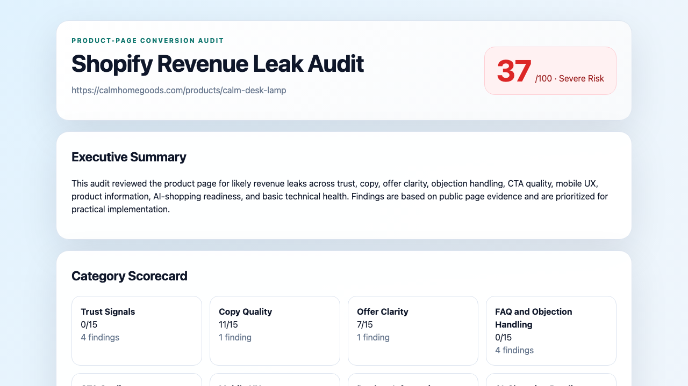

# Shopify Revenue Leak Auditor

Capture public product pages, apply explicit audit rules and produce Markdown/HTML reports for human review. Findings describe potential usability and conversion risks; the tool does not measure lost revenue.

**Status:** local Python CLI with an optional FastAPI interface; the published sample uses fictional fixtures.

**My contribution:** browser capture, extraction, audit rules, scoring, reports and CLI/API delivery.

[Methodology](docs/AUDIT_METHODOLOGY.md) · [Scoring rubric](docs/SCORING_RUBRIC.md) · [Sample report](examples/sample_outputs/demo-product-audit/audit_report.md)



*Fictional fixture report. Original [sample artifacts](examples/sample_outputs/demo-product-audit/) include the desktop/mobile captures and scorecard.*

## How it works

The auditor loads a supplied public URL, captures desktop/mobile views, extracts page signals and applies weighted rules. Categories include trust, copy, offer clarity, objections, calls to action, mobile UX, product information, structured product-discovery content and technical extraction quality.

Outputs include `audit_data.json`, `audit_report.md`, `audit_report.html` and screenshots. Scores are heuristic review aids rather than predictions of customer behavior. A failed live page load retains diagnostic artifacts and exits with status `2`.

The released path is rule-based and requires no model API key. Internal LLM interfaces are extension points, not a delivered inference feature.

## Usage

Requires Python 3.11+. Start with the offline packaged example:

```bash
python -m venv .venv
source .venv/bin/activate
pip install -e '.[api,dev]'
shopify-audit demo
```

For a permitted live public page, install Chromium with `python -m playwright install chromium`, then use `shopify-audit audit-url URL` or `shopify-audit audit-batch FILE`. Run `shopify-audit --help` for output options.

Start the local API with `shopify-audit-api`; see [API service](docs/API_SERVICE.md) for the `POST /audit` contract.

## Validation

```bash
pytest -q -m "not browser"
ruff check .
python -m playwright install chromium
pytest -q -m browser
python -m build
twine check dist/*
```

CI also tests an installed wheel and supported Python versions. Regenerate fictional sample outputs with `python examples/generate_sample_outputs.py`.

## Scope and current state

The public-page workflow does not access Shopify analytics, checkout data, customer recordings, inventory or advertising accounts. Reports identify opportunities requiring human judgment; no conversion lift or revenue outcome is established.

Review generated reports before client delivery. Keep the optional API in a trusted local environment unless authentication, limits and artifact policy have been added.

## Documentation

- [Project overview](docs/PROJECT_OVERVIEW.md) and [methodology](docs/AUDIT_METHODOLOGY.md)
- [Scoring rubric](docs/SCORING_RUBRIC.md)
- [Client report example](docs/CLIENT_REPORT_EXAMPLE.md)
- [API service](docs/API_SERVICE.md) and [limitations](docs/LIMITATIONS.md)

MIT. See [LICENSE](LICENSE).
